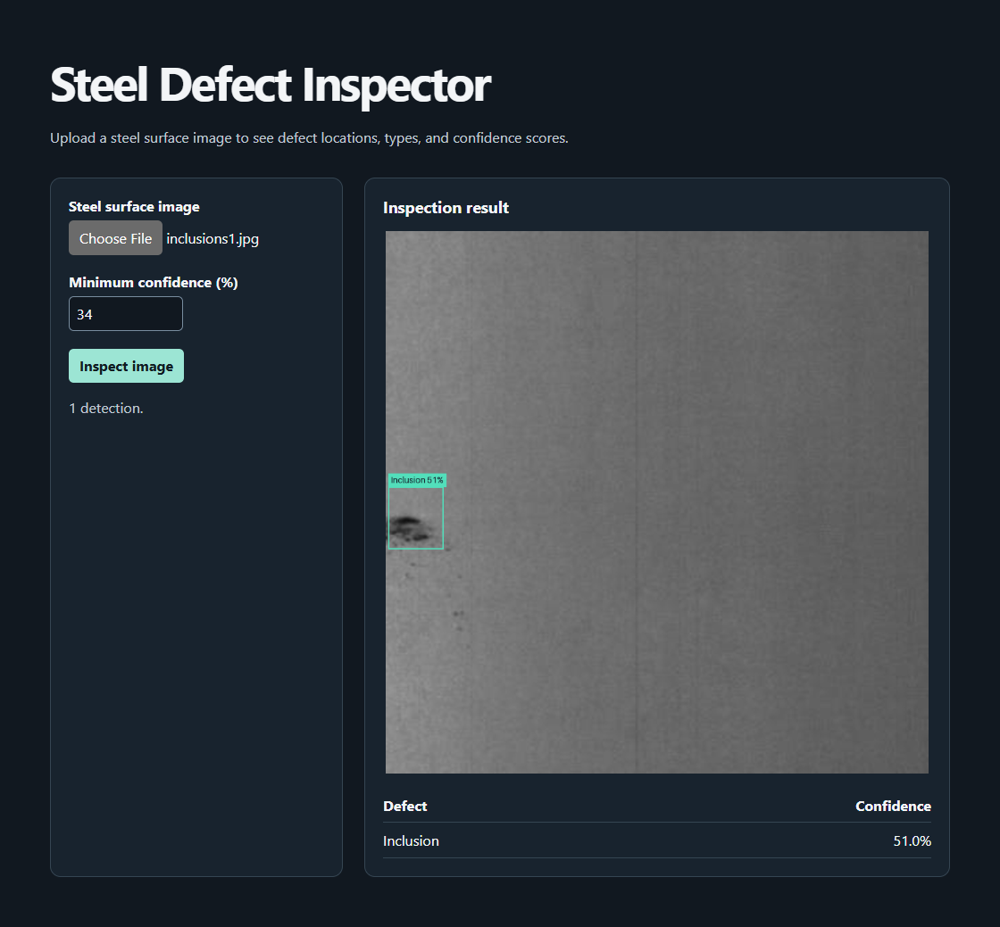

# Steel Defect Inspector

Upload a grayscale or color image of a steel strip to see the detector's bounding boxes, defect names, and confidence scores. The browser demo runs on a local CPU using ONNX Runtime.

The six classes are crazing, inclusion, patches, pitted surface, rolled-in scale, and scratches. The benchmark uses the bounding-box annotations from the NEU-DET release. The maintainers describe 1,800 grayscale images at 200 × 200 pixels. [NEU surface defect database](https://faculty.neu.edu.cn/songkc/en/zdylm/263270/list/index.htm)

## Research benchmark

On **270 NEU-DET test images**, the three-pass YOLO11 system improved the primary metric, **mAP@50:95, by 3.57 percentage points** over DFE-Net retrained on the same project split.

| System | Test mAP@50 | Test mAP@50:95 |
| --- | ---: | ---: |
| DFE-Net, matched retraining | 74.07% | 40.21% |
| Three-pass YOLO11 | **77.04%** | **43.78%** |
| Improvement in percentage points | +2.97 | +3.57 |

The 95% paired image interval for the primary improvement was **+1.89 to +4.87 points**. The comparison uses one training seed and the shared COCO evaluator. Its scope is the matched DFE-Net reproduction on this split. [Test results and limits](EXPERIMENTS.md#matched-held-out-result) · [Machine-readable report](docs/matched-test.json)

## Run the demo



Live CPU demo capture using the 192 px ONNX detector and a 34% score cutoff. The detector annotated `inclusions1.jpg`, an external steel image from CR7-DET. [Jiang, Wang, and Chen, CR7-DET](https://zenodo.org/records/14263276) · [CC BY 4.0](https://creativecommons.org/licenses/by/4.0/)

The lightweight ONNX demo model has these operating points on the 270 NEU-DET test images. [Demo model evaluation](EXPERIMENTS.md)

| Confidence cutoff | Micro-precision | Micro-recall | Micro-F1 |
| --- | ---: | ---: | ---: |
| 0.34, balanced | 62.10% | 56.71% | 59.28% |
| 0.58, high precision | 88.99% | 14.79% | 25.36% |

If you have the local `runs/precision192-e35.onnx` file from training, start with the demo command below. In a fresh checkout, train and export a checkpoint first. The demo needs only the ONNX model and the demo dependencies.

```bash
python -m pip install -r requirements-demo.txt
python app.py --model runs/precision192-e35.onnx --threshold 34
```

Open the local URL, upload a JPG, PNG, BMP, or TIFF, and select **Inspect image**. To prioritize precision, start with `--threshold 58` or set **Minimum confidence** to 58%. Adjust **Minimum confidence** and run the inspection again to see how the detections change. The model sees a resized grayscale image. The demo draws predictions in the original image's orientation and aspect ratio.

## Reproduce training

Use Python 3.14 in a virtual environment. For CPU training, install the PyTorch CPU wheel first.

```bash
python -m pip install torch==2.14.0 --index-url https://download.pytorch.org/whl/cpu
python -m pip install -r requirements.txt
```

For NVIDIA training, install the corresponding CUDA PyTorch wheel and add `--device cuda` to the training command. Download **NEU-DET** from the maintainers and extract the original images and Pascal VOC XML under `data/NEU-DET`. [Official download links](https://faculty.neu.edu.cn/songkc/en/zdylm/263270/list/index.htm)

```bash
python -m steel_inspector prepare --source data/NEU-DET --manifest data/split.json --seed 42
python -m steel_inspector train --manifest data/split.json --output runs/precision192-e35.pt --size 192 --epochs 35 --batch-size 24 --seed 42 --augment
python -m steel_inspector evaluate --manifest data/split.json --checkpoint runs/precision192-e35.pt --split val --output runs/precision192-e35-val.json --tune-threshold --flip-ensemble
```

Preparation pairs XML to photos by filename and converts VOC boxes to zero-based half-open coordinates. It removes repeated boxes, collapses pixel-identical images with equivalent annotations, and excludes images whose identical pixels have conflicting annotations. The seeded 70/15/15 train, validation, and test assignment is stratified by NEU-DET filename class and stored in `data/split.json` with image hashes, labels, geometry, and annotation audit counts.

The model trains from scratch using AdamW and a cosine schedule. It predicts class logits and box offsets on a stride-8 grid, combines two spatial feature scales, and uses focal loss plus a box regression loss. `--flip-ensemble` averages predictions from the original and horizontally mirrored inputs after mapping them to the original coordinates. Export embeds both passes inside the ONNX model.

## Evaluate and export

See [the experiment report](EXPERIMENTS.md) for the measured run and the exact training settings.

The validation report selected `0.34` for maximum micro-F1. Its `threshold_sweep` also supports selecting a high-precision cutoff. For this run, `0.58` gave the highest recall among cutoffs whose validation Wilson lower bound for precision reached 85%. The two test evaluations below use those fixed cutoffs.

```bash
python -m steel_inspector evaluate --manifest data/split.json --checkpoint runs/precision192-e35.pt --split test --output runs/precision192-e35-test-0.34.json --threshold 0.34 --flip-ensemble
python -m steel_inspector evaluate --manifest data/split.json --checkpoint runs/precision192-e35.pt --split test --output runs/precision192-e35-test-0.58.json --threshold 0.58 --flip-ensemble
python -m steel_inspector export --checkpoint runs/precision192-e35.pt --output runs/precision192-e35.onnx --flip-ensemble
python -m steel_inspector compare --manifest data/split.json --checkpoint runs/precision192-e35.pt --onnx runs/precision192-e35.onnx --output runs/precision192-e35-runtime.json --threshold 0.58 --flip-ensemble
```

- Evaluation uses COCO mAP@50:95 and AP@50, a 0.01 candidate score floor, 0.50 class-wise NMS, and at most 100 output boxes per image. For operating-point precision and recall, predictions match ground-truth boxes one-to-one within class at IoU ≥ 0.50. `--tune-threshold` sweeps confidence cutoffs on validation and selects the cutoff with highest micro-F1. Reports include false-positive and missed-box overlays when errors occur. [COCO evaluation implementation](https://github.com/cocodataset/cocoapi/blob/master/PythonAPI/pycocotools/cocoeval.py)
- The CPU comparison checks raw output, final box coordinates, classes, and confidence scores on the same fixed test images. It reports p50 and p95 batch-one latency, including preprocessing, inference, and NMS, after five warm-up passes per runtime. Image file decoding and drawing occur outside the measured interval. Comparison exits with a nonzero status if runtime parity fails.
- The default confidence score is a model output rather than a calibrated probability. NEU-DET is a benchmark for images containing defects. Deployment on a line would also require measurement on defect-free strips, the installed camera, and the production lighting.
- The official dataset page requests citations for use. Check redistribution terms for dataset images, overlays, and derived weights before publishing them. Local model and data artifacts are ignored by Git. [Dataset citation notice](https://faculty.neu.edu.cn/songkc/en/zdylm/263270/list/index.htm)

## Tests

```bash
python -m pip install pytest==9.1.1
python -m pytest -q
```

The CPU tests use generated grayscale fixtures. They cover reproducible splits, box mirroring, NMS, validation-only threshold selection, a one-epoch training run, and PyTorch–ONNX parity for both single-pass and mirrored inference.
